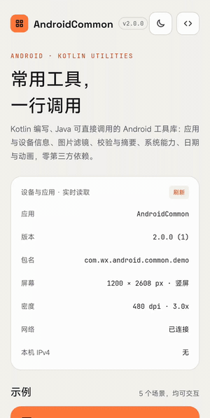
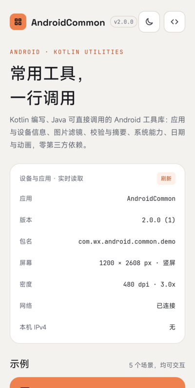
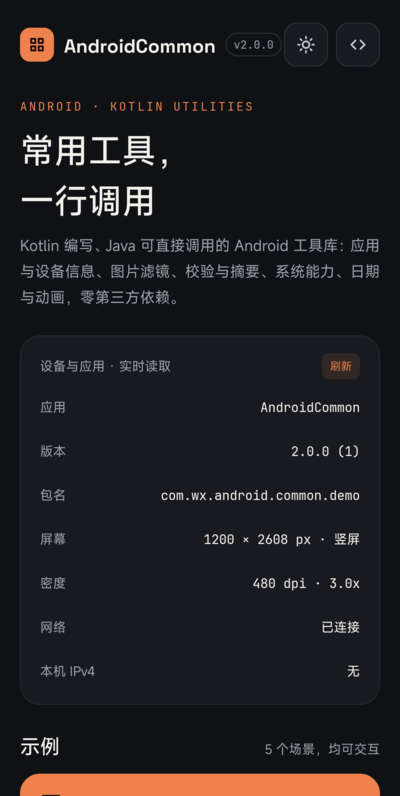
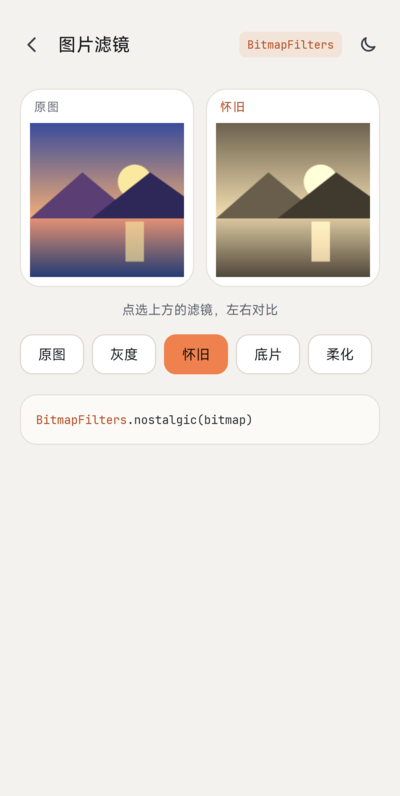
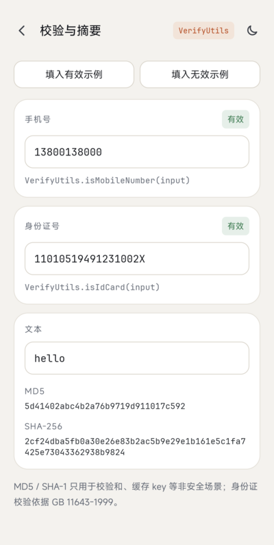
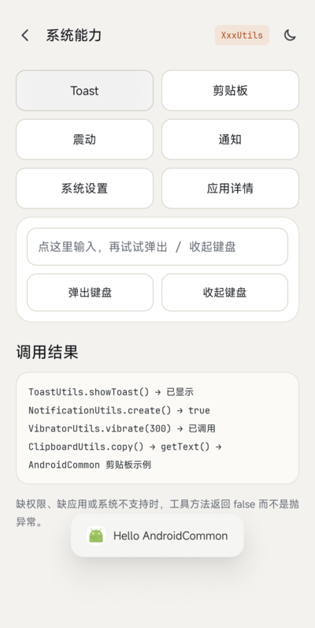
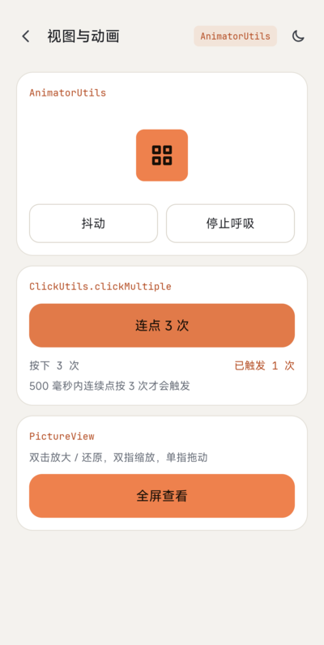
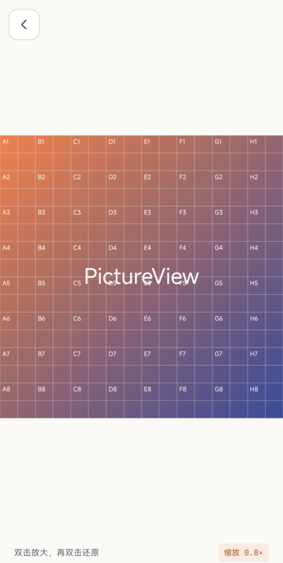
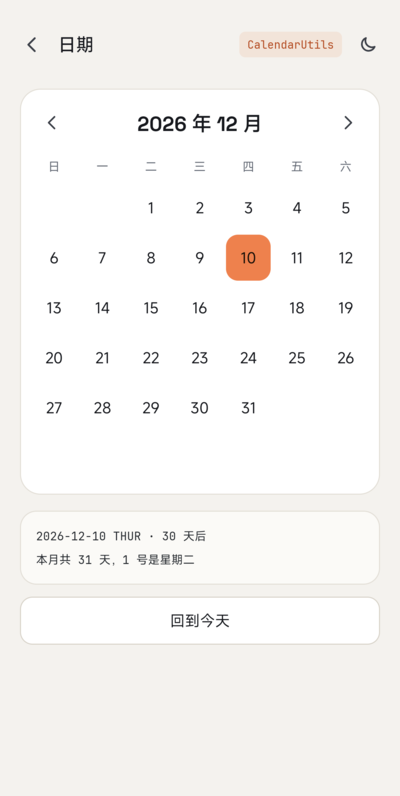

# AndroidCommon

[English](README.md) | 简体中文

[](https://jitpack.io/#venshine/AndroidCommon)  [](https://github.com/venshine/AndroidCommon/actions/workflows/ci.yml)  [](https://developer.android.com/guide/topics/manifest/uses-sdk-element#ApiLevels)

一个小型的 Android 工具类库，用 Kotlin 编写，Java 也可以直接调用。2.0.0 是一次重写：Android 框架、AndroidX 或 Kotlin 标准库已经覆盖的工具类被删除，保留下来的按当前 Android 重写，并补充了单元测试。

[**下载示例 APK**](https://github.com/venshine/AndroidCommon/releases/download/2.0.0/AndroidCommon-sample-2.0.0.apk)

内容
--
全部源码位于 [`common/src/main/kotlin/com/wx/android/common`](common/src/main/kotlin/com/wx/android/common)。

| 方向 | 类 |
|---|---|
| 应用与设备 | `AppUtils`、`DeviceUtils`、`DisplayUtils`、`MemoryUtils`、`NetworkUtils`、`TelephonyUtils` |
| 系统功能 | `ClipboardUtils`、`InputMethodUtils`、`IntentUtils`、`NotificationUtils`、`ShortcutUtils`、`ToastUtils`、`VibratorUtils`、`WindowUtils` |
| 图像与视图 | `BitmapUtils`、`BitmapFilters`、`AnimatorUtils`、`ClickUtils`、`ViewUtils`、`PictureView`、`CommonEditText`、`Colors` |
| 数据与文本 | `CalendarUtils`、`DigestUtils`、`FileUtils`、`ResourceUtils`、`ThreadUtils`、`UrlUtils`、`VerifyUtils` |

[示例 App](sample) 有一个首页（设备与应用信息速览）和五个演示页：图片滤镜、校验与摘要、系统能力、视图与动画、日期。

截图
--


| 首页 | 深色模式 | 图片滤镜 | 校验与摘要 |
|:---:|:---:|:---:|:---:|
|  |  |  |  |

| 系统能力 | 视图与动画 | PictureView | 日期 |
|:---:|:---:|:---:|:---:|
|  |  |  |  |

Usage
--
##### Gradle:
1. 在 `settings.gradle` 中添加 JitPack 仓库：
```groovy
dependencyResolutionManagement {
    repositories {
        google()
        mavenCentral()
        maven { url = 'https://jitpack.io' }
    }
}
```
2. 在模块的 `build.gradle` 中添加依赖：
```groovy
implementation 'com.github.venshine:AndroidCommon:2.0.0'
```

##### Gradle Kotlin DSL:
```kotlin
// settings.gradle.kts
dependencyResolutionManagement {
    repositories {
        google()
        mavenCentral()
        maven("https://jitpack.io")
    }
}

// build.gradle.kts
implementation("com.github.venshine:AndroidCommon:2.0.0")
```

> 旧坐标 `com.wx.android.common:common:1.0.1` 已无法下载。包名 `com.wx.android.common` 不变。
> 库用 Kotlin 编写，会给你的项目带上 `kotlin-stdlib`，除此之外没有其他运行时依赖（不依赖 AndroidX，也不再依赖 Gson）。`minSdk` 为 21。

Demo
--
每个工具类都是 `object`，方法带 `@JvmStatic`，Kotlin 和 Java 的调用写法一致。

##### Kotlin:
```kotlin
import com.wx.android.common.util.*

val md5 = DigestUtils.md5("hello")                     // 5d41402abc4b2a76b9719d911017c592
val ok = VerifyUtils.isIdCard("11010519491231002X")    // true
val size = FileUtils.formatSize(1536)                  // "1.50KB"
val dp = DisplayUtils.dip2px(context, 16f)
ClipboardUtils.copy(context, "text")
ThreadUtils.execute { /* 在后台线程执行 */ }
```

##### Java:
```java
import com.wx.android.common.util.DigestUtils;
import com.wx.android.common.util.VerifyUtils;

String md5 = DigestUtils.md5("hello");
boolean ok = VerifyUtils.isIdCard("11010519491231002X");
```

权限
--
库的清单文件**不声明**任何权限，请按你用到的类自行声明：

| 权限 | 用到它的方法 |
|---|---|
| `ACCESS_NETWORK_STATE` | `NetworkUtils.isNetworkAvailable`、`NetworkUtils.getDNS*` |
| `VIBRATE` | `VibratorUtils` |
| `CALL_PHONE` | `IntentUtils.call`（没有权限时返回 `false`） |
| `SYSTEM_ALERT_WINDOW`，并由用户授予"显示在其他应用上层" | `WindowUtils.addView`（没有授权时返回 `false`） |
| `WRITE_SETTINGS`，并由用户在系统设置里授予 | `DeviceUtils.setScreenBrightness`、`setScreenBrightnessMode`、`setScreenDormantTime`（没有授权时返回 `false`） |
| `POST_NOTIFICATIONS`（较新的 Android 版本上是运行时权限） | `NotificationUtils.create`（没有权限时返回 `false`） |
| `REQUEST_DELETE_PACKAGES` | 较新的 Android 版本上的 `AppUtils.uninstall` |
| `<queries>` 或 `QUERY_ALL_PACKAGES` | `AppUtils` 中查询**其他**应用的方法：较新的 Android 版本只会看到有限的已安装应用 |

使用时需要知道的行为
--
* 因为缺少应用、权限或系统支持而可能失败的方法，返回 `false` / `null`，不抛异常。
* `ToastUtils` 需要先调用一次 `ToastUtils.init(context)`，例如放在 `Application.onCreate`。较新的 Android 版本上文本 Toast 会忽略自定义的位置和偏移。
* `ClipboardUtils`：较新的 Android 版本限制读取剪贴板（后台读取会被拒绝，前台读取时系统可能弹出提示），所以剪贴板有内容时 `getText` 也可能返回 `null`。
* `VerifyUtils.isMobileNumber` 只校验格式 `^1[3-9]\d{9}$`，**不校验号段是否真实分配**。
* `VerifyUtils.isIdCard` 校验 18 位居民身份证号码：数字、真实存在且不晚于今天的出生日期，以及 GB 11643-1999 规定的校验码。不校验地址码，不支持 15 位号码。
* `DigestUtils.md5` 和 `sha1` 只适合做校验和、缓存 key，它们在安全场景下已被攻破；需要安全摘要请用 `sha256`，存密码请用专门的密码哈希函数。
* `BitmapFilters` 在 CPU 上逐像素计算，处理大图请放到后台线程。

从 1.x 迁移
--
2.0.0 与 1.x **源码不兼容**。下表列出所有被删除或有变化的内容。

##### 已删除：请使用替代方案

| 1.x | 2.0.0 替代方案 |
|---|---|
| `ArrayUtils`、`CollectionUtils`、`MapUtils`、`ObjectUtils` | Kotlin 标准库：`isNullOrEmpty()`、`joinToString()`、`toList()` / `toSet()` / `toTypedArray()`、`entries.firstOrNull { ... }`、`==` |
| `StringUtils.isEmpty / equals / isNumeric / toLowerCase / toUpperCase` | `isNullOrEmpty()`、`==`、`all(Char::isDigit)`、`lowercase()` / `uppercase()` |
| `StringUtils.encodeString / decodeString` | `UrlUtils.encode / decode` |
| `BASE64Utils` | `android.util.Base64` |
| `MD5Utils.encodeMD5 / encodeMD52` | `DigestUtils.md5`（仅限校验和） |
| `SHA1Utils.SHA1 / toHexString` | `DigestUtils.sha1`、`DigestUtils.toHex`；优先用 `DigestUtils.sha256` |
| `ByteUtils`、`SerializableUtils` | `Parcelable`、`kotlinx.serialization` 或 JSON。对不可信数据使用 Java 原生序列化并不安全 |
| `JsonUtils` | `kotlinx.serialization`、Moshi 或 Gson，由你的应用自行引入（Gson 不再是传递依赖） |
| `AssetsUtils.getTextFromAssets / getTextFromAssets2` | `ResourceUtils.getTextFromAssets` |
| `AssetsUtils.getFileFromAssets`、`AssetsUtils.parseJsonTo*` | `context.assets.open(name)` 加你自己的 JSON 库 |
| `IOUtils.close` | `Closeable.use { }` |
| `PropertyUtils.getPropertyValue` | `java.util.Properties().apply { load(stream) }.getProperty(key)` |
| `NumberUtils.*` | `String.format(Locale, ...)`、`BigDecimal.setScale`、`DecimalFormat` |
| `RandomUtils.*` | `kotlin.random.Random`、`List.shuffled()`、`java.security.SecureRandom` |
| `CommonUtils.generateId` | `View.generateViewId()` 或 `AtomicInteger` |
| `LogUtils.d / e` | `android.util.Log` 或 Timber |
| `ReflectUtils.*` | 已删除。较新的 Android 版本限制反射访问隐藏 API，所以不再提供这类封装 |
| `ShellUtils.*` | 已删除。需要 root 能力请使用专门的 root 库 |
| `SystemUtils.*` | `Build.BRAND`、`Build.MODEL`、`Build.VERSION.SDK_INT`、`Build.SUPPORTED_ABIS` 等 |
| `CpuUtils.*` | `Runtime.getRuntime().availableProcessors()`、`Build.SUPPORTED_ABIS` |
| `ServiceUtils.isServiceRunning / stopRunningService` | 已删除。Android 8.0 起 `ActivityManager.getRunningServices` 只会返回你自己的服务 |
| `SharedPreferencesUtils.*` | Jetpack DataStore，或 `SharedPreferences.edit { }`（androidx.core） |
| `HandlerUtils.runOnUiThread / runOnUiThreadDelay / removeRunable` | `ThreadUtils.runOnUiThread / runOnUiThreadDelayed / removeCallbacks` |
| `FragmentUtils.*` | `FragmentManager.commit { }`（androidx.fragment） |
| `CameraUtils.openCamera`、`IntentUtils.takeCamera` | `ActivityResultContracts.TakePicture`（只想打开相机应用可用 `IntentUtils.openCamera`） |
| `ImageUtils.openPicture`、`IntentUtils.choosePhoto` | `ActivityResultContracts.PickVisualMedia` / `GetContent` |
| `BlurUtils.fastBlur` | Android 12 及以上用 `RenderEffect.createBlurEffect`，或使用图片库 |
| `ScrollListView`、`ScrollGridView`、`ViewUtils.get/setListViewHeight`、`get/setGridViewHeight` | `NestedScrollView` 里放 `RecyclerView` |
| `WebActivity` | Custom Tabs（`androidx.browser`），或你自己的 WebView 页面 |
| `CommonCfg` | 已删除（它是个空类） |
| `TimeUtils.getCurrentTime / getCurrentTimeMillis` 及 `%Y` 风格的格式常量 | `CalendarUtils.getTime(millis, pattern)`（使用 `SimpleDateFormat` 的格式串）、`System.currentTimeMillis()` |

##### 已删除：Android 不再允许

| 1.x | 原因 |
|---|---|
| `TelephonyUtils.getIMEI / getIMSI / getSimSerialNumber / getLine1Number` | Android 10 起 IMEI 和序列号需要系统级的 `READ_PRIVILEGED_PHONE_STATE` 权限，第三方应用拿不到（[Android 10 隐私变更](https://developer.android.com/about/versions/10/privacy/changes)）；`getDeviceId` 自 API 26 起已废弃（[TelephonyManager](https://developer.android.com/reference/android/telephony/TelephonyManager)）。需要安装标识请使用应用自己生成的 UUID |
| `TelephonyUtils.getCallState / getDataActivity / getDataState / getNetworkType` | 需要 `READ_PHONE_STATE`，在较新的 Android 版本上受限；请在应用里使用 `TelephonyCallback` |
| `DeviceUtils.getUUID` | 由 IMEI 和 SIM 序列号拼成（见上），请自行生成并保存 UUID |
| `DeviceUtils.getAirplaneMode / setAirplaneMode / isAirplaneModeOpen` | 当前 Android 版本上第三方应用不能修改飞行模式设置 |
| `DeviceUtils.getBluetoothState / setBluetooth / isBluetoothOpen` | `BluetoothAdapter.enable()` 自 API 33 起废弃，对以该版本为目标的应用总是失败（[BluetoothAdapter](https://developer.android.com/reference/android/bluetooth/BluetoothAdapter)） |
| `NetworkUtils.getWlanMacAddress / getEthernetMacAddress` | Android 6.0 起 `WifiInfo.getMacAddress()` 恒返回 `02:00:00:00:00:00`（[Android 6.0 变更](https://developer.android.com/about/versions/marshmallow/android-6.0-changes)）；Android 10 默认随机化 MAC 地址 |
| `NetworkUtils.getWlanGateway / getWlanMask / getEthernetGateway / getEthernetMask` | 通过 `getprop` 读取系统属性，不是受支持的接口；请使用 `ConnectivityManager.getLinkProperties` |
| `AppUtils.isAppInBackground` | 依赖 `getRunningTasks`，它自 API 21 起不再对第三方应用开放（[ActivityManager](https://developer.android.com/reference/android/app/ActivityManager)）。请使用 `ProcessLifecycleOwner`（androidx.lifecycle） |
| `PackageUtils.install`、`PackageUtils.getAllApps` | 安装需要 `FileProvider` URI 和 `REQUEST_INSTALL_PACKAGES`，库无法替你配置；较新的 Android 版本通过包可见性限制了对其他应用的列举 |

##### 已移动或有变化

| 1.x | 2.0.0 |
|---|---|
| `PackageUtils.*` | 合并进 `AppUtils`：`isInstalled`（原 `isInsatalled`）、`isSystemApp`（原 `isSystemApplication`）、`startApp`、`checkPermission`、`uninstall`、`getInstalledPackages`（原 `getInsatalledPackageInfos`） |
| `AppUtils.getVersionCode`、`getAppVersionCode` | 返回 `Long`（长版本号），包不存在时返回 `-1` |
| `AppUtils.getAppSignature` | `AppUtils.getAppSignatures`（证书列表）和 `getAppSignatureSha256` |
| `AppUtils.isApkDebugable` | `AppUtils.isApkDebuggable(context, packageName)` |
| `CleanUtils.*` | `FileUtils.cleanInternalCache / cleanExternalCache / cleanFiles / cleanDatabases / cleanSharedPreferences / cleanCustomCache / cleanApplicationDatas`。旧的 `cleanDatabases` / `cleanSharedPreferences` 指向了错误的目录，实际什么也没清 |
| `FileUtils.getFolderSize` | 同名，不再抛受检异常 |
| `FileUtils` 的复制 / 移动 / 删除 / 读写 / 取名称等方法 | Kotlin 的 `File` 扩展（`copyTo`、`readText`、`deleteRecursively`、`extension` 等）。`FileUtils.moveFile(src, dest)` 保留 |
| `MemoryUtils.getFormatSize` | `FileUtils.formatSize(Long)` |
| `MemoryUtils.getTotalMemory / getAvailableMemory / getAllMemory` | `getTotalMemory(context)` / `getAvailableMemory(context)` 以 `Long` 返回字节数（原来返回格式化后的字符串） |
| `MemoryUtils.*ExternalMemorySize()` | 需要传 `Context`，统计应用专属外部目录所在的卷，不可用时返回 `-1`。`isExternalMemoryFull` 已删除 |
| `ShortcutUtils.addShortCut / deleteShortCut / hasShortCut` | `ShortcutUtils.requestPin(...)`，仅 API 26 及以上可用（低于 26 返回 `false`）。Android 8.0 起 `INSTALL_SHORTCUT` 广播已无效（[Android 8.0 变更](https://developer.android.com/about/versions/oreo/android-8.0-changes)） |
| `NotificationUtils.create(...)` | 新签名 `create(context, id, title, content, smallIcon, pendingIntent?, ongoing, autoCancel, largeIcon, channelId)`；自动创建通知渠道，没有 `POST_NOTIFICATIONS` 时返回 `false` |
| `NotificationUtils.getPendingIntentFor*` | 参数顺序调整为 `context, intent, flags, requestCode`；默认加上 `FLAG_IMMUTABLE` |
| `IntentUtils.*` | 方法名不变（上面提到的相机 / 相册方法除外）；全部返回 `Boolean`，没有对应应用或缺少权限时不再抛异常 |
| `InputMethodUtils.toggleSoftInput` | 已删除（平台已废弃）；请使用 `showSoftInput` / `hideSoftInput` |
| `ToastUtils.showToast(String, ...)` | 改为 `showToast(CharSequence, ...)`；`showToastAlways` 和 `hideToast` 已删除（它们依赖 Toast 的私有字段），`cancel()` 取代 `hideToast` |
| `ThreadUtils.execute / submit / shutdown / getUIThreadId` | 方法名不变。线程池满时任务会排队，不再被悄悄丢弃 |
| `VibratorUtils.*` | 方法名不变；较新的系统上使用 `VibrationEffect` / `VibratorManager` |
| `WindowUtils.addView` | 没有悬浮窗权限时返回 `false`；使用 `TYPE_APPLICATION_OVERLAY` |
| `ResourceUtils` | 只保留 `getResourceByName`、`getTextFromAssets`、`getRawText`。取字符串、颜色、Drawable 等请直接用 `Context.getString`、`getColor`、`getDrawable` 等 |
| `DeviceUtils` 的设置类方法 | 没有 `WRITE_SETTINGS` 授权时返回 `false`，不再抛异常 |
| `DisplayUtils.getStatusBarHeight2`、`getTitleBarHeight` | 已删除；`getStatusBarHeight` 优先读取窗口 insets，取不到时回退到系统资源 |
| `URLParse` | `UrlUtils.parse(url)`，返回数据类 `ParsedUrl` |
| `UrlUtils.encode / decode` | 方法名不变，不抛受检异常；`decode` 遇到格式非法的输入时原样返回 |
| `VerifyUtils.isChineseCard` | `VerifyUtils.isIdCard`（完整校验，见上）。不再接受 15 位号码 |
| `VerifyUtils.isMobileNumber` | 规则改为 `^1[3-9]\d{9}$`（旧规则会拒绝大部分现行号段） |
| `VerifyUtils.isEmail / isEmail2 / isUrl` | `android.util.Patterns.EMAIL_ADDRESS` / `Patterns.WEB_URL` |
| `VerifyUtils.isNumber / isLetter / isNumberAndLetter / isPostCode` | 已删除（`all(Char::isDigit)` 等） |
| `CalendarUtils` | `isToday` / `isYesterday` 现在同时检查当天的起止（之前任何更晚的时间都算"今天"）；`TIME_FORMAT` 末尾改为毫秒（`SSS`） |
| `BitmapUtils` 滤镜（`convertGreyImg`、`adjustTone`、`nostalgic`、`soften`、`sunshine`、`film`、`sharpen`、`emboss`、`saturation`、`lum`、`hue`、`lumAndHueAndSaturation`） | 移到 `BitmapFilters`。现在返回 ARGB_8888 位图并保留 alpha；`film` 会连最外一圈像素一起反色，`hue` 是真正的色相旋转，`lumAndHueAndSaturation` 三项调节都会生效，`sharpen` 在平坦区域保持原样 |
| `BitmapUtils.convertToBlackWhite` | 代码与 `convertGreyImg` 完全相同，请使用 `BitmapFilters.convertGreyImg` |
| `BitmapUtils.resToDrawable`、`bitmapToByte`、`byteToBitmap`、`bitmapToDrawable`、`drawableToByte`、`byteToDrawable` | `Context.getDrawable`、`Bitmap.compress`、`BitmapFactory.decodeByteArray`、`BitmapDrawable` |
| `BitmapUtils.screenshot`、`decodeBitmap(Bitmap, format, quality)`、`compressBitmap(Bitmap, double)`、`scale(Bitmap, double, double)` | 已删除（`screenshot` 依赖已废弃的 drawing cache；`compressBitmap(Bitmap, double)` 从来没有产生过效果；需要精确尺寸请用 `zoom`） |
| `BitmapUtils.compressBitmap(Bitmap)` | `compressBitmap(Bitmap, maxKb = 100)`，质量降到 10 就停止，不再崩溃 |
| `BitmapUtils.createWatermarkBitmap` | 水印完整地放在右下角内侧，可选 `padding` 参数 |
| `AnimatorUtils.*` | 方法名不变；每个方法返回已启动的 `ObjectAnimator` |
| `ClickUtils.clickMultiple` | 签名不变；计数按 View 分别保存（旧实现用静态字段，所有 View 共用） |
| `ClipboardUtils.getText` | 返回 `String?` |
| `Colors` | `object Colors` 加 `const val`；去掉了 `@ColorInt` 注解（不依赖 AndroidX） |
| `ViewUtils.getTextViewHeight`、`findTextView` | 方法名不变；`findTextView` 遇到空的 `ViewGroup` 不再崩溃 |
| `PictureView`、`CommonEditText` | 类名和监听接口不变；`PictureView` 遇到非位图的 Drawable 时不再崩溃，而是忽略手势 |
| `TelephonyUtils`（其余方法）、`NetworkUtils.isNetworkAvailable / getLocalIPv4 / getLocalIPv6 / getDNS1 / getDNS2` | 保留（`getDNS1/2` 现在需要传 `Context`，返回 `String?`） |

维护状态
--
本项目低频维护：只做缺陷修复和兼容性更新，不再增加大的新功能。欢迎提 Issue 和 Pull Request。

本地检查命令：`./gradlew :common:testDebugUnitTest :common:assembleRelease :sample:assembleDebug :sample:testDebugUnitTest`。测试在 Robolectric（固定 SDK 35）和纯 JVM 上运行。示例 App 已在 Android 17 真机上逐页走过一遍。

Author
--
* Email：venshine.cn@gmail.com

Credits
--
示例 App 打包了以下字体，均为 [SIL Open Font License 1.1](https://openfontlicense.org) 协议（协议原文见 [`sample/licenses/`](sample/licenses)）：
* [Space Grotesk](https://github.com/floriankarsten/space-grotesk)：Copyright 2020 The Space Grotesk Project Authors
* [JetBrains Mono](https://github.com/JetBrains/JetBrainsMono)：Copyright 2020 The JetBrains Mono Project Authors

库本身不包含任何字体。

License
--
    Copyright (C) 2015 venshine.cn@gmail.com

    Licensed under the Apache License, Version 2.0 (the "License");
    you may not use this file except in compliance with the License.
    You may obtain a copy of the License at

    http://www.apache.org/licenses/LICENSE-2.0

    Unless required by applicable law or agreed to in writing, software
    distributed under the License is distributed on an "AS IS" BASIS,
    WITHOUT WARRANTIES OR CONDITIONS OF ANY KIND, either express or implied.
    See the License for the specific language governing permissions and
    limitations under the License.
